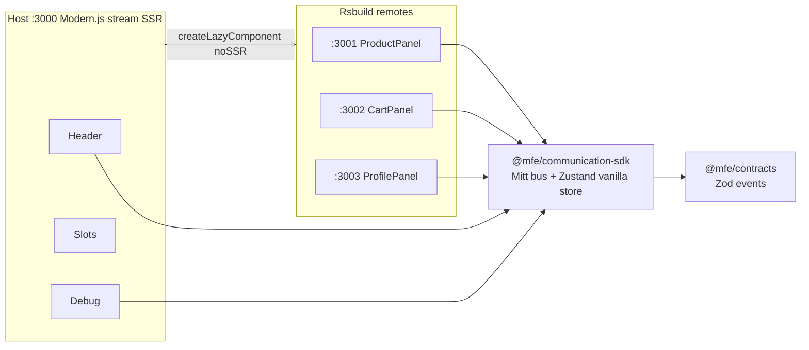

# Architecture

Northwind Atelier is a pnpm workspace with one Modern.js host and three Rsbuild remotes. The host is the only composer. No app imports another app's source. The boundary test in `boundaries.test.ts` fails the build if that rule is broken.

## Packages

| Package | Job |
| --- | --- |
| `@mfe/contracts` | Zod schemas for products, cart lines, users, and the four `AppEvent` variants. Also the two demo users and `formatPrice`. |
| `@mfe/communication-sdk` | `publish`, `onAny`, `appStore`, `resetCommunication`. One Mitt emitter and one Zustand vanilla store per JavaScript realm. |
| `@mfe/tsconfig` | Shared `base.json` and `react.json`. |

`publish` parses the payload with `AppEventSchema` before it touches the store or the bus. A rejected payload throws and leaves both channels unchanged.

## Module Federation

The host uses the official Modern.js v3 integration:

- `@module-federation/modern-js-v3` `moduleFederationPlugin()` in `apps/host/modern.config.ts`
- `createModuleFederationConfig` in `apps/host/module-federation.config.ts`
- `server.ssr.mode: 'stream'` and `server.port: 3000`
- Consumption through `createLazyComponent` and `lazyLoadComponentPlugin` from `@module-federation/modern-js-v3/data-fetch`

Each remote uses `@module-federation/rsbuild-plugin` `pluginModuleFederation` and exposes one component module:

| Remote | Expose | Dev manifest |
| --- | --- | --- |
| product | `./ProductPanel` | `http://127.0.0.1:3001/mf-manifest.json` |
| cart | `./CartPanel` | `http://127.0.0.1:3002/mf-manifest.json` |
| profile | `./ProfilePanel` | `http://127.0.0.1:3003/mf-manifest.json` |

React, React DOM, and `@mfe/communication-sdk` are shared singletons. The host marks React and the SDK `eager: true` so the shell provides them. The SDK sets `requiredVersion: false` because the workspace dependency specifier is `workspace:*`, which is not a semver range Module Federation can satisfy.

The panels are component exports. The host does not use `createBridgeComponent` or `createRemoteAppComponent`. Those application-level modules cannot be server-rendered.

## Why `noSSR` is set

A production-shaped Rsbuild app build emits `mf-manifest.json` with `metaData.remoteEntry.type: "global"` and no `ssrRemoteEntry`. The Modern.js server runtime then tries to evaluate `remoteEntry.js` in Node and fails with `self is not defined`. `createLazyComponent` accepts `noSSR: true`, so the host still stream-renders its own shell and the browser loads the remotes after hydration.

The supported ways to get remote HTML into the stream are a Modern.js producer that also sets `server.ssr.mode: 'stream'`, or an Rslib producer built with `pluginModuleFederation(..., { target: 'dual' })`. `target: 'dual'` is only supported as a global plugin in Rslib or Rspress, not in an Rsbuild app. See [poc-findings.md](./poc-findings.md).

## UI

The host shell owns the masthead and the debug panel. The masthead reads the shared user and the cart count. The debug panel lists the store log and counts Mitt deliveries. Each remote owns its panel and can also be opened on its own port.
