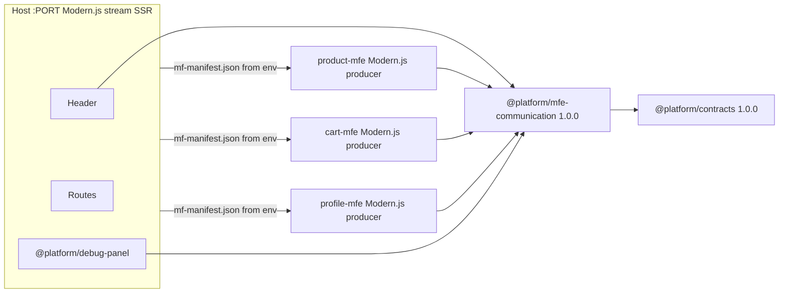

# Architecture

Northwind Atelier is a proof of concept for independently deployable React microfrontends composed by a Modern.js v3 host. The monorepo is only a development convenience. Each app depends on the shared packages with semver ranges (`^1.0.0`), not `workspace:*`, and remote URLs come from environment variables.

## Technology substitution

The spec lists Rsbuild for MFE builds. Rsbuild application builds emit a browser `remoteEntry` and no `ssrRemoteEntry`, so the Modern.js server cannot render them (`self is not defined`). Official Module Federation docs support two producer shapes for streaming SSR:

- A Modern.js v3 app with `server.ssr.mode: 'stream'` and `@module-federation/modern-js-v3`.
- An Rslib library with `pluginModuleFederation(..., { target: 'dual' })`. `target: 'dual'` is not supported for Rsbuild apps.

This repo uses Modern.js producers. Modern.js 3 already bundles with Rspack, each app still has its own `build` and `serve`, and the manifest includes `ssrRemoteEntry` (`type: commonjs-module`). That is what puts product names in the host's HTTP response. The substitution is documented here and in `poc-findings.md`.

## Ownership

| State | Owner | Who may write it |
| --- | --- | --- |
| Authentication, language, navigation | Host | Host command handlers only |
| Cart lines | Cart MFE | `CartController`, stored on the shared runtime object |
| Product selection | Product MFE | Local React state |
| Translations | Each MFE | Its own dictionary |

MFEs call `requestLogin`, `requestLogout`, `requestLanguageChange`, and `requestNavigation`. Those publish a command envelope and then invoke the host handler. They do not call `applyAuth` or `applyLanguage`.

The host uses Modern.js file routes. The layout renders `<Outlet />`, the header uses `Link`, and the navigation command calls `useNavigate`. `src/modern.runtime.ts` sets `router.useTransitions` to `false` so those updates commit. React Router otherwise wraps them in `startTransition`, and `useSyncExternalStore` in the shared store forces a synchronous render that drops the transition before the matched view commits. Each route has a `page.data.ts` loader. Cart and profile redirect anonymous requests to `/products?notice=auth`. The layout loader does not revalidate, so the browser runtime survives client navigation.

## Module Federation

Shared singletons use the versions exported by `@platform/contracts`:

- `react` and `react-dom`: `^19.3.1`
- `@platform/mfe-communication` and `@platform/contracts`: `^1.0.0`

The host marks them `eager: true`. Remotes use the same ranges with `eager: false`. Producers emit `static/remoteEntry.js` and `static/mf-manifest.json`, which `modern serve` actually hosts (`dist/static` and `dist/bundles` are public; files at the dist root are not). Remote URLs come from `config/remotes.json`. `createFederationRemotes` turns each `env` name into a `name@url` entry, and `scripts/generate-remotes.mjs` writes the literal `import('name/Export')` calls Module Federation requires. There is no `127.0.0.1` literal in the federation config. `@platform/contracts` holds schemas and the data they describe. Functions such as `federationShared`, `redact`, and `formatPrice` live in `@platform/debug-panel/lib`. The host aliases that helpers entry to its file path so Module Federation DEV does not merge the React debug panel and the shared SDK into one package graph. The communication SDK is split into `runtime`, `auth`, `language`, `navigation`, `events`, and `server` folders and still publishes one package entry so the shared runtime stays a singleton. The host also calls `registerShared` with its React, React DOM, SDK, and contracts modules, because the server bundle does not put those providers into the webpack share scope on its own. Without that registration each remote evaluates a second React and `useContext` is null during SSR.

`MF_DTS=1` turns on Module Federation type generation when the producers are reachable. Otherwise each host keeps a local ambient module shim (`remote-modules.d.ts`) that does not import another app. Payload types live in `@platform/contracts`.

## Separate repositories

Pack the shared packages and install them into a copy of each app that lives outside this workspace. `pnpm prove:split` does that, runs `modern build` and `modern serve` for each app on ports 3100–3103, checks the product name in the server HTML, and runs the e2e suite against that host. See the README.
