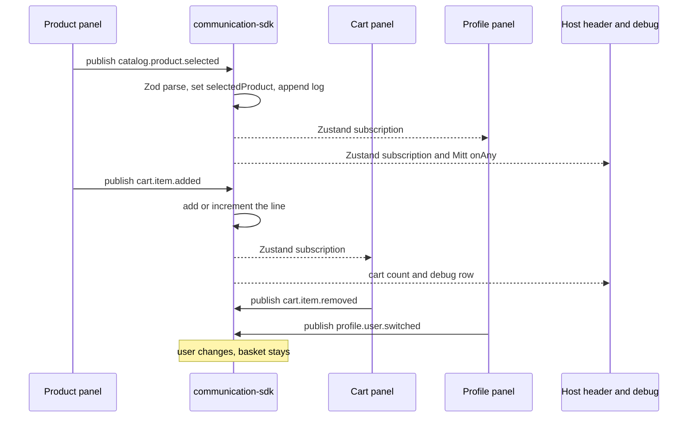

# Communication flow

All cross-app messages are `AppEvent` values from `@mfe/contracts`. A remote never imports another remote. It calls `publish` from `@mfe/communication-sdk`.

## Events

| Event | Who publishes | Store effect |
| --- | --- | --- |
| `catalog.product.selected` | Product, when "Look at this" is pressed | `selectedProduct` |
| `cart.item.added` | Product, when "Add to cart" is pressed | insert the line, or add to `quantity` when `productId` matches |
| `cart.item.removed` | Cart, when Remove is pressed | drop that `productId` |
| `profile.user.switched` | Profile, when the switch button is pressed | replace `user`. The basket is kept. |

`publish` does three things, in order:

1. `AppEventSchema.parse`. Failure throws `ZodError` and does not emit.
2. `appStore.setState` with the reduced state and a log row capped at 30 entries.
3. `bus.emit(event.type, event)`.

The host debug panel reads the log from the store and also subscribes with `onAny`, so a row and the "Mitt deliveries" counter both move. That shows the bus and the store are the same channels, not two divergent copies.

## Singleton

`getRuntime()` stores the bus and the store on `globalThis` under `Symbol.for('@mfe/communication-sdk/runtime')`. Module Federation also lists the package as a shared singleton. Either mechanism is enough inside one browser window. The symbol is the backstop when the bundler evaluates the package twice. Tests call `resetCommunication()`, which clears Mitt listeners and resets state without replacing the store object.

## What does not cross the network

Events are in-memory. They are not posted to the server, stored in `localStorage`, or sent over `BroadcastChannel`. A second browser tab has its own runtime. The server process also has a runtime, but render code only reads the initial state (Mara Ellison, empty basket), so the SSR HTML matches the first client render of the shell.
