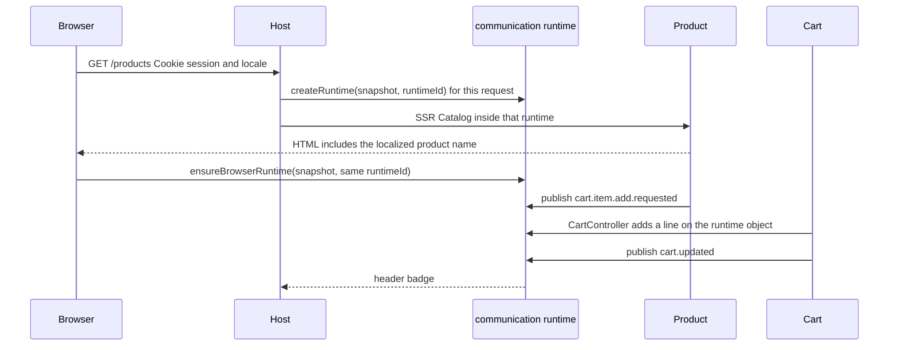
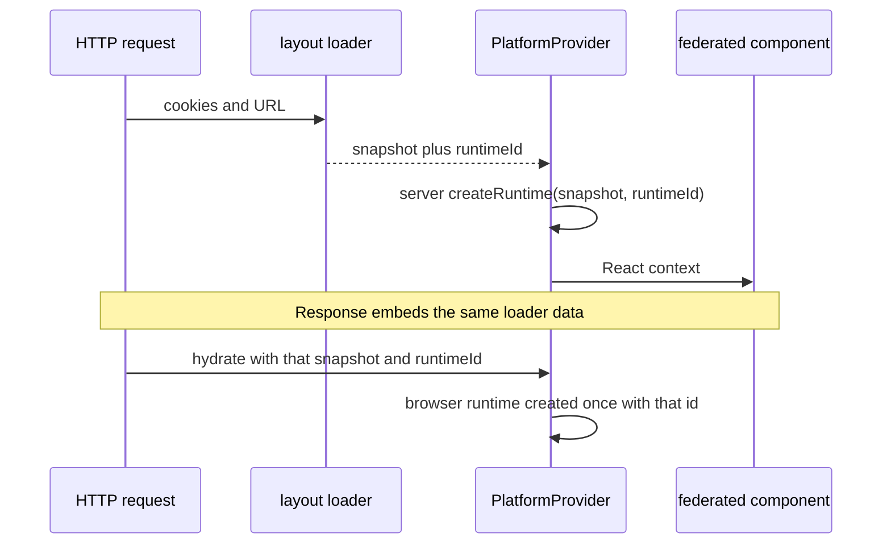
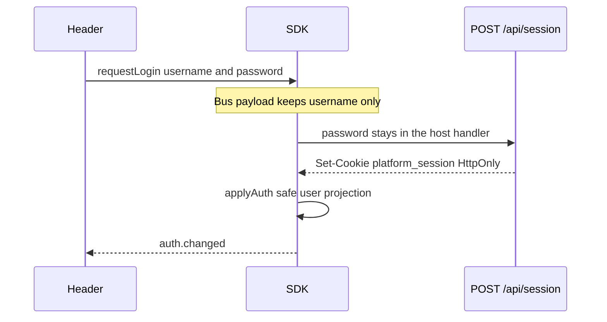

# Communication flow

Mitt delivery is synchronous and in-process. Command handlers may be asynchronous because login talks to the host's HTTP API. There is no replay, persistence, or exactly-once guarantee. Contract version is `1`. A message whose `version` is not `1` fails Zod validation and is recorded on the runtime instead of being emitted.



## SSR and hydration



The server render and the first client render use the same `runtimeId` from the loader, so the debug panel does not mismatch. Each request constructs its own runtime. The browser keeps one runtime for the document.

## Authentication



Mock passwords live only in `apps/host/server/modern.server.ts`. The shared store never receives them. Logout is `DELETE /api/session`, then `auth.changed` to anonymous, and the cart controller clears lines for that runtime. A later production system can replace the cookie with an opaque session id issued by OAuth 2.0 or OpenID Connect. The projection in the store stays `{ id, displayName, roles }`.

## Language

```mermaid
sequenceDiagram
  participant Actor as Host selector or Profile
  participant SDK
  participant MFEs
  Actor->>SDK: language.change.requested
  SDK->>SDK: host sets platform_locale cookie and applyLanguage
  SDK-->>MFEs: language.changed
  Note over MFEs: Each dictionary reads useLanguage
```

Refreshing the document sends the cookie, and the SSR HTML is already in that locale.

## Cross-MFE cart

The product MFE does not import the cart app. It publishes `cart.item.add.requested`. `CartController` stays mounted on every host page, owns the line items on the runtime object (`Symbol.for('@platform/cart-lines')`), and publishes `cart.updated`. The host badge stores only `{ count }`.

Navigation commands are checked with `isSafeDestination`. External URLs and unknown paths are rejected. `/cart` and `/profile` also require an authenticated snapshot. The host then updates the visible route with `history.pushState` and renders the matching remote without a full reload. A direct URL load still goes through Modern.js SSR.
